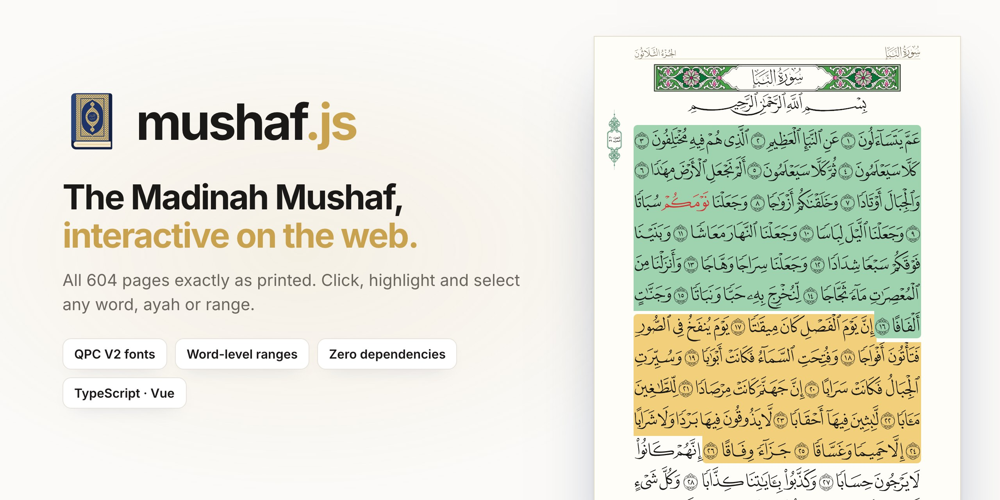

<p align="center"></p>

# mushaf.js

[](https://www.npmjs.com/package/mushaf.js)
[](https://github.com/YouBar/mushaf-js/actions/workflows/ci.yml)
[](https://bundlephobia.com/package/mushaf.js)
[](https://www.npmjs.com/package/mushaf.js)
[](packages/core/package.json)
[](LICENSE)

An interactive Madani Mushaf for the web. mushaf.js renders all 604 pages of the Madinah
Mushaf (Hafs 'an 'Asim, KFGQPC V2 print) exactly as printed, and makes every word, ayah
and surah interactive: click it, highlight it, select a range of it.

**[Documentation](https://mushafjs.com/getting-started)** · **[Live demo](https://mushafjs.com/demo)** · [mushafjs.com](https://mushafjs.com)

- **Faithful to the print:** QPC V2 per-page fonts, 15 lines per page, calligraphic surah
  headers and basmala, and the margin ornaments for juz, hizb and rub'.
- **Word-level interaction:** click events for words, ayah markers, surah headers and
  juz/hizb/rub' markers. Every word has a position you can store.
- **Highlighting that follows the calligraphy:** highlights are measured from the glyph ink,
  so swashes and harakat aren't cut off. Background, underline, border or colour styles.
- **Ranges and selection:** highlight from any word to any word, across lines and pages, or
  let the user select a range with two taps.
- **Zero setup:** page data and fonts load from `cdn.mushafjs.com`. Self-hosting is optional.
- **Small and dependency-free:** works with a `<script>` tag or as an npm package, with
  TypeScript types, dark mode, RTL, touch and keyboard navigation built in.
- **Vue component** included (`@mushafjs/vue`).

## Installation

```bash
npm install mushaf.js
```

Or use the browser bundle:

```html
<link rel="stylesheet" href="https://cdn.mushafjs.com/mushaf.min.css" />
<script src="https://cdn.mushafjs.com/mushaf.min.js"></script>
<!-- exposes the global `Mushaf`: new Mushaf.Mushaf({ … }) -->
```

These URLs always serve the latest release. To pin a version, use
`https://cdn.mushafjs.com/v1.0.2/mushaf.min.js` (and `…/mushaf.min.css`).

## Quick start

```html
<div id="mushaf"></div>

<script type="module">
  import { Mushaf } from 'mushaf.js';
  import 'mushaf.js/styles';

  const mushaf = new Mushaf({
    container: '#mushaf',
    onWordClick: (word) => console.log(`${word.surah}:${word.ayah}:${word.word}`, word.text),
  });

  await mushaf.init();
  await mushaf.goToAyah(2, 255); // Ayat al-Kursi
</script>
```

The page scales to the width of its container: every page renders at the same size and
every line is justified exactly as in the print.

## Usage

### Navigation

```js
await mushaf.renderPage(1);
await mushaf.nextPage();
await mushaf.previousPage();
await mushaf.goToSurah(18);
await mushaf.goToAyah(36, 1);
```

Arrow keys and swipes turn pages in the reading direction (`←` / swipe left = next page).

### Events

```js
new Mushaf({
  container: '#mushaf',
  onWordClick: (word, element) => {},
  onAyahClick: (ayah) => {},
  onSurahClick: (surah) => {},
  onJuzClick: (juz) => {},
  onHizbClick: (hizb) => {},
  onRubClick: (rub) => {},
  onPageChange: (page) => {},
});
```

### Highlighting

```js
mushaf.highlightWord(1, 2, 1);
mushaf.highlightAyah(2, 255, { style: 'underline', color: '#2e7d32' });
mushaf.highlightSurah(112);

// Word-level ranges, across lines and pages; keep several under your own keys.
mushaf.highlightRange(
  { surah: 78, ayah: 1, word: 1 },
  { surah: 78, ayah: 16, word: 999 }, // 999 = end of the ayah
  { key: 'homework', style: 'background', color: '#ffc828' },
);

mushaf.clearHighlight('homework');
```

### Range selection

```js
const mushaf = new Mushaf({
  container: '#mushaf',
  onSelectionChange: (selection) => console.log(selection), // { start, end } or null
});

mushaf.startSelection(); // tap a start word, then an end word
```

### Vue

```bash
npm install mushaf.js @mushafjs/vue
```

```vue
<script setup>
import { ref } from 'vue';
import { MushafViewer } from '@mushafjs/vue';
import 'mushaf.js/styles';

const page = ref(1);
</script>

<template>
  <MushafViewer v-model:page="page" @word-click="(word) => console.log(word)" />
</template>
```

## Documentation

The full documentation is at **[mushafjs.com](https://mushafjs.com)**.

- [Getting started](https://mushafjs.com/getting-started)
- [Configuration](https://mushafjs.com/configuration)
- [API reference](https://mushafjs.com/api-reference)
- [Events](https://mushafjs.com/events), [navigation](https://mushafjs.com/navigation) and [highlighting](https://mushafjs.com/highlighting)
- [Vue](https://mushafjs.com/vue)
- [Use cases](https://mushafjs.com/use-cases/): memorization tracking, assigning ranges, follow-along, bookmarks
- [Page data](https://mushafjs.com/data) and [fonts](https://mushafjs.com/fonts)

## Self-hosting the assets

By default page data and fonts load from `https://cdn.mushafjs.com`. To host them yourself,
serve the same structure (the files are in [`data/`](data/) and [`fonts/`](fonts/)) and
point the library at it:

```js
new Mushaf({
  container: '#mushaf',
  dataBaseUrl: '/mushaf/pages',  // metadata.json and page-index.json one level up
  fontsBaseDir: '/mushaf/fonts',
});
```

See [fonts](https://mushafjs.com/fonts) and [page data](https://mushafjs.com/data) for the exact layout.

## Browser support

Current versions of Chrome, Edge, Firefox and Safari. mushaf.js uses CSS container
queries for sizing and the `FontFace` and canvas `TextMetrics` APIs for fonts and ink
measurement.

## Contributing

Contributions are welcome. See [CONTRIBUTING.md](CONTRIBUTING.md).

## Credits

- **Qur'an data:** page layout, glyph codes, text and metadata from
  [QUL, the Quranic Universal Library](https://qul.tarteel.ai/) by Tarteel. The original
  files are in [`data/source/`](data/source/).
- **Fonts:** QPC V2 per-page fonts and the QCF basmala/title font, © King Fahd Glorious
  Qur'an Printing Complex. Details in [`fonts/NOTICE.md`](fonts/NOTICE.md).

## License

The code is [MIT](LICENSE) licensed. The Qur'an data and fonts keep their own terms; see
[`fonts/NOTICE.md`](fonts/NOTICE.md) and [`data/source/`](data/source/).
